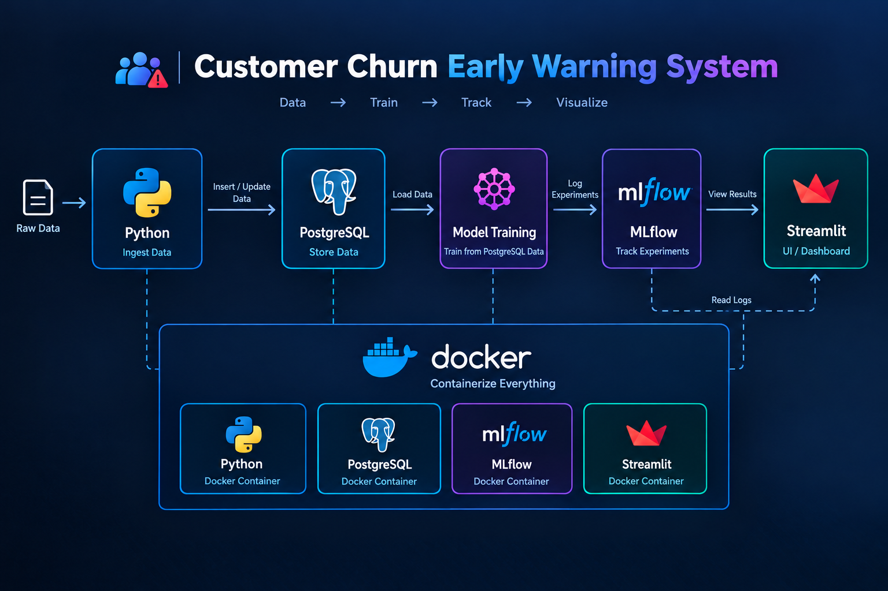
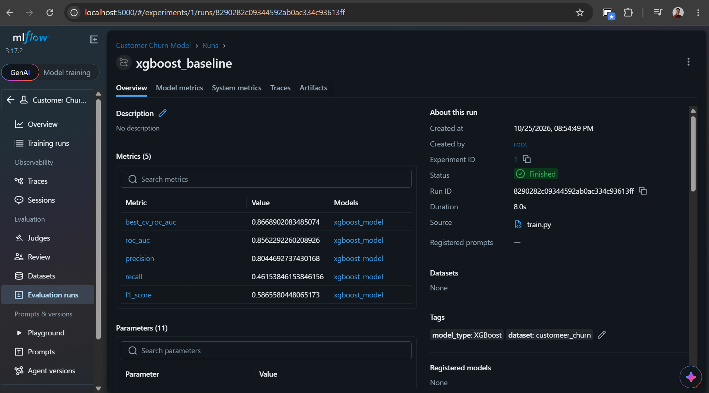
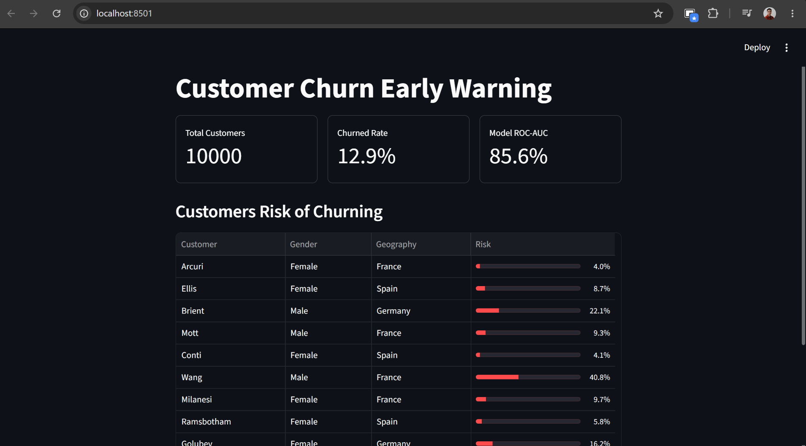

# Customer Churn Early-Warning System

An end-to-end machine learning project that predicts which bank customers are likely to leave the bank within the next 90 days, so a retention team can reach out to the right customers first.

The pipeline covers data ingestion, model training with experiment tracking, a results database, and an interactive dashboard, all containerized with Docker.

# Business problem

A retention team cannot call or message every customer. If a customer quietly becomes inactive and moves their money elsewhere, the bank usually finds out too late.

**Question:** which customers are most at risk of leaving in the next 90 days, and what is driving that risk?

- Target: 1 if the customer closes their accounts or has no transactions in the 90 days after a snapshot date, otherwise 0.
- Business metric: share of true leavers (and balance at risk) captured when the team contacts only the top 10% highest-risk customers.

# Dataset:
- get this dataset from [kaggle](https://www.kaggle.com/datasets/mathchi/churn-for-bank-customers/data)

# Pipeline Flow:


# Tech stack
Language = Python 3.11
Database = PostgreSQL 16
ML = scikit-learn, XGBoost
Experiment tracking	= MLflow
UI = Streamlit
Containers = Docker, Docker Compose
Data handling = pandas, SQLAlchemy, psycopg2

# Quick Start

```
# 1. Clone the repository
git clone
cd customer_bank_churn

# 2. Build and start everything
docker compose up --build
```

Then open:

- Dashboard: http://localhost:8501
- MLflow UI: http://localhost:5000

# MLflow Overview


# App Overview


# Limitations
- The data is synthetic, so performance will not transfer to real customers.
- Single time-based split; no cross-validation across multiple periods yet.
- Scoring runs on demand, not on a schedule.
- No model monitoring after training.
- The model predicts risk, not the best retention action.

# Improvement roadmap

The first version is deliberately simple. This section describes how I plan to improve the **model** and the **pipeline** step by step.

**Ground rules**
- Every change is one **experiment**, logged in MLflow with a clear name, so runs can be compared.
- Change **one thing at a time**, using the same time-based test set and the same random seed.
- Record the feature set and data version as MLflow tags for every run.
- Only promote a model if PR-AUC and recall at top 10% improve, and the gain holds across several snapshot windows, not just one.

#### Experiment plan

| ID | Change | Hypothesis | Metric to watch | Status |
|---|---|---|---|---|
| E1 | Logistic regression baseline | Gives a reference point to beat | PR-AUC, recall @ top 10% | Planned |
| E2 | XGBoost with default settings | Captures non-linear patterns | PR-AUC | Planned |
| E3 | Add trend and rolling features | Falling activity is an early warning signal | PR-AUC, recall @ top 10% | Planned |
| E4 | Handle class imbalance (class weights, threshold tuning) | Improves recall on the rare leaver class | Recall @ top 10% | Planned |
| E5 | LightGBM and CatBoost | May beat XGBoost on mixed features | PR-AUC | Planned |
| E6 | Hyperparameter tuning with Optuna | Better settings improve ranking | PR-AUC | Planned |
| E7 | Probability calibration | Scores become usable as real probabilities | Calibration curve, Brier score | Planned |
| E8 | Ensemble of the best models | Reduces variance | PR-AUC, stability across windows | Planned |
| E9 | Survival analysis | Predicts when a customer is likely to leave, not just if | Concordance index | Planned |
| E10 | Uplift modeling | Finds customers who respond to an offer | Uplift at top 10% | Later |

#### Feature engineering ideas

| Group | Ideas |
|---|---|
| Trend | change in transaction count versus the previous 30/90 days, balance momentum, slope of weekly activity |
| Ratios | mobile share of transactions, withdrawals divided by deposits, balance divided by the customer's own 12-month average |
| Recency | days since last transaction, last login, last salary credit |
| Engagement | login streaks, drop in logins, product usage breadth |
| Relationship | number of products, tenure buckets, recent product closures |
| Service | complaint count, unresolved complaint age, call-center contacts before a drop in activity |
| Seasonality | month, payday cycle, holiday periods |
| Segment context | customer versus segment average |

**Selection process:** start wide, check importance with SHAP, remove weak or redundant features, and re-run the experiment to confirm that nothing got worse.

### B. Pipeline improvement

| Area | Current (v1) | Improvement | Possible tools |
|---|---|---|---|
| Data quality | Basic checks in code | Validate schema, nulls, and ranges before training and scoring; fail early | Pandera, Great Expectations |
| Transformations | Python in `features.py` | SQL models with built-in tests and lineage | dbt |
| Testing | Manual | Unit tests, plus a **leakage test** that proves features only use data before the snapshot | pytest |
| CI/CD | None | Lint, tests, and Docker build on every push | GitHub Actions, ruff |
| Orchestration | Manual `docker compose` commands | Scheduled monthly pipeline: ingest, validate, train, score | Airflow or Prefect |
| Model registry | Run history in MLflow | Champion and challenger aliases, promote only if better | MLflow Model Registry |
| Serving | Streamlit reads the scores table | Add an API for scoring and what-if predictions | FastAPI |
| Monitoring | None | Data drift, prediction drift, and real accuracy once 90-day outcomes are known; alert and trigger retraining | Evidently |
| Reproducibility | Fixed seed | Config file, pinned dependencies, versioned datasets | `config.yaml`, DVC |
| Security | `.env` file | No secrets in the repo, rotate credentials, least-privilege database users | Docker secrets |
| Logging | Print statements | Structured logs with run ids | Python `logging` |